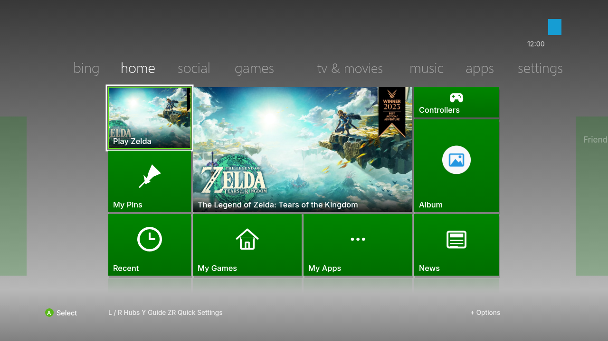

# HomeNX 360 for Switch

An experimental Xbox 360 styled dashboard for an existing HomeNX installation.
It recreates the gray background, green tile groups, large featured panel and
top navigation from the supplied reference, using your Switch's games and art.
Nintendo's separate system applets keep their existing interfaces.
Tabs use a short slide and fade transition, controlled by the existing
**Animations** setting. Controller input stays active during the transition.



This is a layout preview, not a screenshot from Switch hardware.

## Install and rollback

Read [the installation guide](homenx360/INSTALL.md) before installing. Start with
the standalone preview NRO. The HOME update selects **CardsNX** in NXToggle;
in this fork, that look opens the 360 dashboard.

The reported console is running Atmosphere 1.12.1 and system 22.5.0. **Hardware
compatibility has not been verified.** Both native builds and host navigation
checks passed locally; the archive's layout, executable formats and hashes were
checked. See [validation](homenx360/VALIDATION.txt) and the
[local build manifest](homenx360/LOCAL-BUILD-MANIFEST.json).

## Get a build from GitHub Actions

The **Build HomeNX 360** workflow builds the source and uploads an artifact named
**HomeNX360-experimental** containing:

- `HomeNX360-preview.nro`: standalone app to try before changing HOME.
- `HomeNX360-update.zip`: SD card update for an existing HomeNX installation.
- `INSTALL.md` and `BUILD-MANIFEST.json`.

PR checks can run the workflow. Once the workflow is on your default branch,
you can also open **Actions → Build HomeNX 360 → Run workflow**. After a successful
run, download the artifact from the run summary. Extract that download first;
the inner `HomeNX360-update.zip` contains the SD card layout. Do not copy this
source repository directly onto the SD card.

## Source and local builds

The complete modified files are readable in [the source overlay](homenx360/overlay/).
[HomeNX360.patch](homenx360/HomeNX360.patch) contains the changes against upstream.
The preparation script fetches `ad3333m/homenx` at the fixed commit
`94f2bd56698fed40f2897131ea09463775840767`, initializes its submodules and applies
the overlay. It refuses to overwrite an existing dirty checkout.

With devkitPro devkitA64, its Switch packages, xmake 3.1.2, CMake and Python 3:

```sh
python3 tools/prepare_homenx360.py
cd build/homenx360-source
g++ -std=c++20 tests/dashboard360_test.cpp -o /tmp/dashboard360-test
/tmp/dashboard360-test
xmake f --yes -p cross -m release -a aarch64 --toolchain=devkita64 --homebrew=n
xmake build HomeNX-Loader
mkdir -p projects/menu/src/generated
python3 tools/embed_loader.py build/cross/aarch64/release/HomeNX-Loader.nro projects/menu/src/generated/loader_nro.inc
xmake build -j2 CardsNX
xmake build -j2 SwitchU
python3 tools/package_dashboard360.py --output ../artifacts
```

The GitHub workflow rebuilds the daemon from source. The earlier local package
used the unmodified official daemon from upstream workflow 198 at the same source
revision; its provenance is recorded in the local build manifest. A local build
passing does not establish that the new GitHub workflow has passed.

## Credits and license

Based on [HomeNX by ad3333m](https://github.com/ad3333m/homenx), licensed under
[GPL-3.0](LICENSE). Upstream source and credits are retained through the pinned
checkout and [third-party notices](THIRD_PARTY_NOTICES.md). Selawik Light is
Copyright 2015 Microsoft Corporation and is distributed unmodified under the
[SIL Open Font License 1.1](homenx360/overlay/projects/cards/romfs/fonts/Selawik-OFL.txt).
This project is not affiliated with Nintendo or Microsoft.
